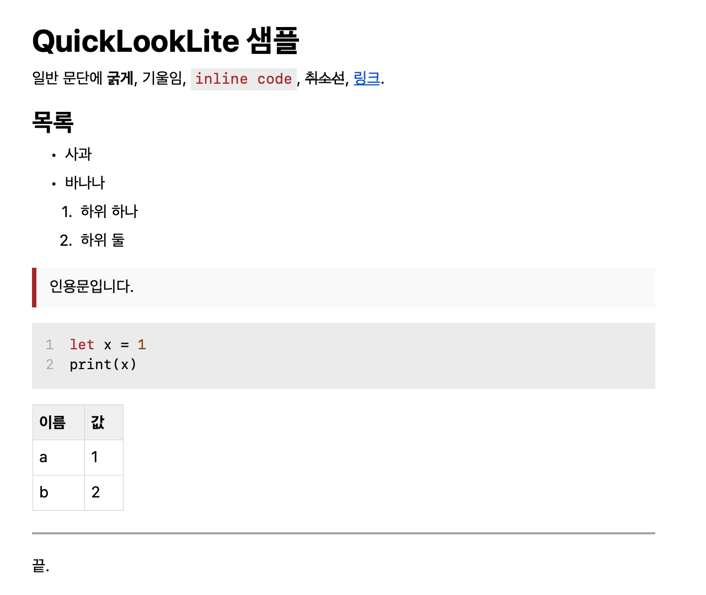

# QuickLookLite

Finder 에서 스페이스로 여는 **Quick Look 미리보기**와, `.md` 를 더블클릭하면 열리는 **가벼운 마크다운 편집기**.

- 앱 전체 약 630KB. 외부 라이브러리 없이 macOS 내장 기능(Foundation 마크다운 파서, AppKit 텍스트 뷰)만 쓴다
- 마크다운은 렌더링해서, 코드·설정 파일은 문법 색상을 입혀서 보여 준다
- 4K 모니터를 고려해 모니터마다 창 크기와 확대 배율을 따로 기억한다



---

## 1. Quick Look 미리보기

Finder 에서 파일을 고르고 스페이스를 누르면 뜬다.

### 대상 형식

| 형식 | 확장자 | 미리보기 |
|---|---|---|
| 마크다운 | `md` `markdown` | 렌더링 |
| Java | `java` | 문법 색상 |
| JavaScript | `js` `mjs` `jsx` | 문법 색상 (jsx 는 태그·속성 포함) |
| TypeScript | `tsx` | 문법 색상 (태그·속성·TS 기본 타입 포함) |
| PHP | `php` | 문법 색상 |
| SQL | `sql` | 문법 색상 (키워드 대소문자 무시) |
| JSON | `json` | 키와 값을 다른 색으로 |
| XML | `xml` | 태그·속성·속성 값·주석·엔티티 |
| CSS | `css` `scss` | at-rule·속성·변수·색상값·단위 |
| 셸 | `sh` `bash` `zsh` | 키워드·`$변수`·주석 |
| 설정 | `yaml` `yml` `properties` | 키 강조·주석·true/false·숫자 |

- `scss`·`jsx`·`properties` 는 macOS 가 모르는 확장자라 앱이 형식(UTI)을 선언해 연결한다
- **넣지 않은 것**
  - `csv`: 시스템의 `Office.qlgenerator` 가 우선이라 등록해도 불리지 않는다. macOS 기본 미리보기도 표로 보여 준다
  - `.ts`: macOS 가 동영상(MPEG-2 TS)으로 인식한다. 가로채면 동영상 미리보기가 깨질 수 있어 뺐다 (`.tsx` 는 된다)

### 마크다운 렌더링

| 요소 | 모양 |
|---|---|
| 제목 `#`~`######` | 크기·굵기 단계 |
| 굵게·기울임·취소선·링크 | 그대로 (한글은 기울임체가 없어 기울임이 안 보인다) |
| 인라인 코드 `` `x` `` | 붉은 글자 + 옅은 회색 배경, 좌우 여백 |
| 코드블록 ```` ``` ```` | 블록 전체 회색 배경 + 언어별 문법 색상 + 줄 번호 (두 줄 이상일 때) |
| 목록 `-` `1.` | 본문보다 들여쓰고, 기호(•·번호)는 본문 앞 7pt 에 오른쪽 정렬. 번호가 `10.` 이 돼도 점 위치가 맞는다 |
| 작업 목록 `- [ ]` `- [x]` | □ / ☑ (보기 전용) |
| 표 | 1픽셀 테두리, 헤더 회색 배경, 열 정렬(`:---:`) 반영 |
| 인용 `>` | 왼쪽 붉은 막대 + 아주 옅은 배경, 여러 문단도 한 덩어리 |
| 수평선 `---` | 줄 전체 폭 2pt 회색 선 (표 테두리와 구분되게 더 굵고 진하게) |
| HTML 주석 `<!-- -->` | 숨긴다. 목록 번호를 끊는 용도(번호 고정)는 그대로 동작 |
| `<br>` | 줄바꿈 (표 셀 안에서 흔히 쓴다) |

**표는 HTML 표처럼 그린다.**

- 열마다 최소 너비(가장 긴 단어)와 최대 너비(줄바꿈 없는 전체 내용)를 재 둔다
- 화면에 다 들어가면 내용 너비 그대로 그리고, 안 들어가면 최소 너비를 보장한 뒤 긴 글이 있는 열부터 줄인다
- 창 크기·배율이 바뀌면 다시 배분한다. 가로 스크롤은 생기지 않는다
- 빈 칸(`| | 제목 |`)도 칸으로 채워 열이 어긋나지 않는다. 목록 안의 표는 목록 들여쓰기에 맞춘다

**한글 줄바꿈**은 글자 중간이 아니라 띄어쓰기에서 한다.

### 문법 색상

Claude 입력창의 인라인 코드 색(`#B53834`)을 기준으로 맞췄다. 다크 모드는 같은 계열의 밝은 색을 쓴다.

| 대상 | 라이트 | 다크 |
|---|---|---|
| 키워드·태그·인라인 코드 글자 | `#B53834` | `#F0807A` |
| 문자열 | `#2E7D4F` | `#8FCB9B` |
| 주석 | `#8A8A8A` | `#8C8C8C` |
| 숫자·단위·엔티티 | `#9A5B13` | `#E0A96D` |
| 타입·키·속성 이름·변수 | `#2A6496` | `#7FB5E6` |
| 코드 배경 | `#EFEFEF` | `#2C2C2C` |

규칙은 언어별 키워드 목록 + 정규식이라 **"대부분 맞는" 수준**이다. 왼쪽부터 주석·문자열을 먼저 잡기 때문에 문자열 안의 `//` 나 주석 안의 키워드는 칠하지 않는다.

### 공통

- 코드 파일과 마크다운 코드블록에 줄 번호가 붙는다. 번호는 글자가 아니라 여백에 그린 것이라 드래그해서 복사해도 딸려 오지 않는다
- 창 크기·확대 배율은 아래 3절을 따른다 (편집기에서 맞춘 배율을 미리보기도 쓴다)
- 다크 모드를 따른다
- 인코딩: UTF-8 로 안 읽히면 CP949(EUC-KR)로 다시 읽는다. BOM 은 지운다
- 1MB 넘는 파일은 색칠 없이 보여 준다 (미리보기가 늦게 뜨지 않게)

---

## 2. 편집기

`./build.sh --default-md` 로 설치하면 `.md` 의 기본 앱이 되어 더블클릭으로 원문 편집 창이 열린다. 아니면 "다음으로 열기"에서 고른다.

- **원본 / 미리보기** 전환: 툴바 가운데 버튼 또는 `⌘E`. 미리보기는 Quick Look 과 같은 렌더링이다
- **편집 중 서식 표시** (`⇧⌘E`, 기본 켜짐): 원문은 그대로 두고 `**굵게**` 는 굵게, 기호는 흐리게, 제목은 크게,
  코드블록은 배경과 문법 색상, `[ ]`·`[x]` 와 목록 기호는 주황으로 칠한다. 끄면 평문 고정폭
- 자동 저장 (macOS 문서 방식). `⌘S` 도 된다
- 한글 입력 중(조합 중)에는 서식을 다시 칠하지 않는다

### 단축키

| 키 | 동작 |
|---|---|
| `⌘N` / `⌘O` / `⌘S` / `⌘W` | 새로 만들기 / 열기 / 저장 / 닫기 |
| `⌘E` | 원본 ↔ 미리보기 |
| `⇧⌘E` | 편집 중 서식 표시 켜기·끄기 |
| `⌘=` / `⌘-` / `⌘0` | 확대 / 축소 / 실제 크기(100%) — 25% 단위, 50~300% |
| `⌘F` | 찾기 |
| `⌘Z` / `⇧⌘Z` | 실행 취소 / 실행 복귀 |

트랙패드 핀치로도 확대되지만 그 배율은 저장하지 않는다.

---

## 3. 창 크기와 확대 배율

마우스가 있는 모니터를 기준으로 정한다.

| | 기본값 | 바꾸면 |
|---|---|---|
| 창 크기 | 화면의 가로 50% × 세로 80%, 화면 가운데 | 편집기 창 크기를 조절하면 그 모니터의 크기로 기억 |
| 확대 배율 | 배율 없이 쓰는 4K(1x, 가로 3000pt 이상) **175%**, 그 밖 **125%** | `⌘=`·`⌘-` 로 바꾸면 그 모니터의 배율로 기억 |

- 편집기 창을 다른 모니터로 옮기면 그 모니터의 배율로 바뀐다
- Quick Look 미리보기도 같은 배율을 읽는다 (앱 설정을 읽기 전용으로 공유)
- 표 테두리·수평선은 배율과 상관없이 픽셀 격자에 맞춰 그려 번지지 않는다

설정은 `kr.hwangti.quicklooklite` 도메인에 있다 (`zoomByScreen`, `windowSizeByScreen`, `styledEditing`).

---

## 4. 설치·빌드

필요한 것: macOS 12 이상(마크다운 파서가 macOS 12 부터 있다. 개발·확인은 macOS 27 에서만 했다), Xcode 또는 Command Line Tools(`xcode-select --install`).

빌드된 앱은 배포하지 않는다(배포하려면 Developer ID 서명·공증이 필요). 각자 소스에서 빌드한다.

```bash
./build.sh
```

`.md` 기본 앱으로도 지정하려면:

```bash
./build.sh --default-md
```

하는 일:

1. `swiftc` 로 앱(`QuickLookLite`)과 Quick Look 확장(`QuickLookLitePreview.appex`)을 빌드
2. 서명 — 키체인에 개발자 인증서가 있으면 그것으로, 없으면 ad-hoc
3. `/Applications/QuickLookLite.app` 에 설치하고 Launch Services 등록. 프로젝트의 `build/` 사본은 등록을 풀고 지운다
4. Quick Look 확장 등록·사용 켜기 (등록이 비동기라 목록에 보일 때까지 기다렸다 켠다), 미리보기 캐시 초기화
5. (`--default-md` 일 때만) `.md` 기본 앱으로 지정

미리보기가 예전 모습이면 Finder 창을 닫았다가 다시 스페이스를 누른다.

### 지우기

```bash
pluginkit -r /Applications/QuickLookLite.app/Contents/PlugIns/QuickLookLitePreview.appex
```

```bash
rm -rf /Applications/QuickLookLite.app
```

```bash
defaults delete kr.hwangti.quicklooklite
```

---

## 5. 구조

| 파일 | 내용 |
|---|---|
| `Sources/Markdown.swift` | 공용: 마크다운 렌더링, 코드 렌더링·문법 색상, 편집기 서식 표시, 표(`FitTable`·`HairlineCell`), 확대 스크롤 뷰, 배율·창 크기 |
| `Sources/Preview.swift` | Quick Look 확장: 확장자로 마크다운/코드 렌더러를 고른다 |
| `Sources/main.swift` | 편집기 앱: 문서(`NSDocument`), 툴바, 메뉴, 확대, 창 크기 기억 |
| `Info.plist` | 앱 — `.md` 편집기 등록, `scss`·`jsx`·`properties` 형식 선언 |
| `PreviewInfo.plist` | 확장 — Quick Look 대상 형식 |
| `preview.entitlements` | 확장 샌드박스 + 앱 설정(배율) 읽기 권한 |
| `build.sh` | 빌드·서명·설치·등록 |
| `screenshot.png` | README 용 미리보기 화면 (`sample.md`) |
| `AppIcon.icns` · `icon.swift` | 앱 아이콘 · 그 아이콘을 그리는 스크립트 (`swift icon.swift` 로 다시 생성) |
| `sample.md` | 확인용 샘플 |

렌더링은 TextKit 1 텍스트 뷰를 쓴다. TextKit 2 는 표(`NSTextTable`)와 블록 배경(`NSTextBlock`)을 그리지 않는다.

---

## 6. 알려진 한계

- 이미지는 대체 텍스트(alt)만 보인다
- 작업 목록 체크박스는 보기 전용이다. 클릭으로 바꾸지 않는다 (편집기 원본에서 `[ ]` ↔ `[x]`)
- 문법 색상은 키워드 목록 기반이다. 여러 줄 문자열(`"""` 등)은 지원하지 않는다
- 칸 너비보다 긴 인라인 코드는 앞 여백만 윗줄에 남을 수 있다 (아주 좁은 칸·높은 배율에서)
- 미리보기에서 인라인 코드를 복사하면 앞뒤 여백 공백이 하나씩 딸려 온다 (원문·저장 파일과는 무관)
- 개발자 인증서 없이 ad-hoc 서명으로 빌드했을 때 Quick Look 확장이 잡히는지는 확인하지 않았다

---

## 라이선스

[MIT](LICENSE)
